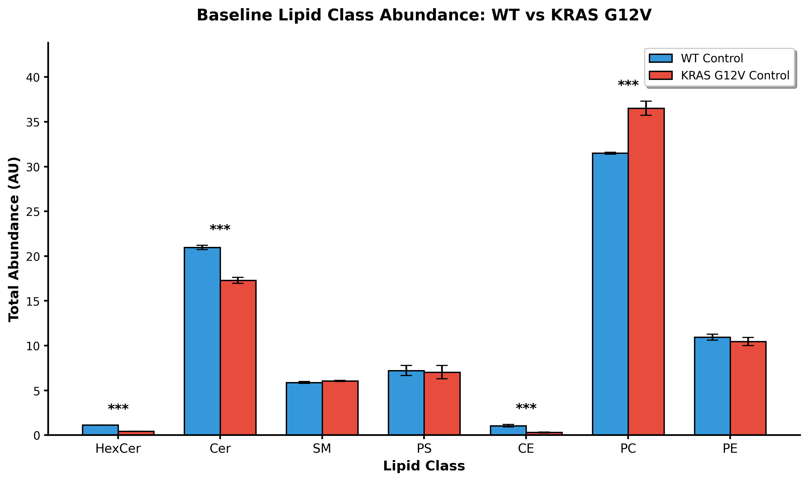
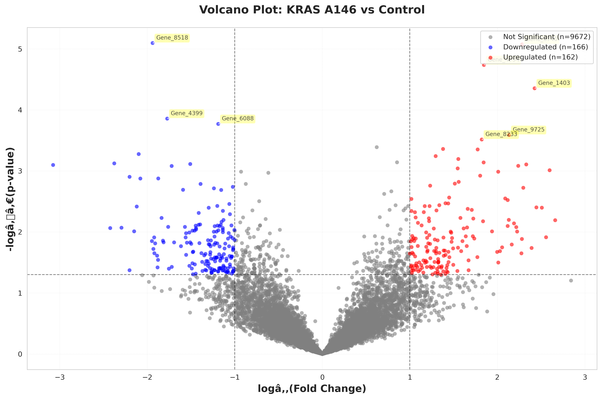
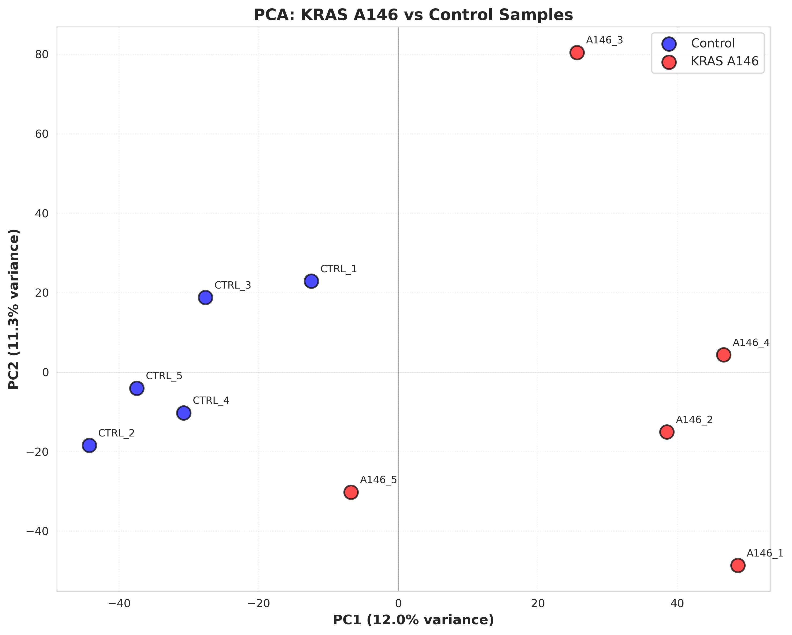

# Multi-omics dissection of therapeutic resistance in KRAS-mutant cancers

Final project for **BINF6420: Omics in Bioinformatics** (Northeastern University, Fall 2025, Prof. Max Wolf).

**Authors:** Koushik Muthuselvam · Sarvesh Sunil Kurup

This repository holds the research proposal and the analysis code behind its preliminary-data figures. The proposal argues for a four-layer omics study (transcriptomics, phosphoproteomics, lipidomics, epigenomics) of how KRAS-mutant tumours escape KRAS inhibitors, with the goal of nominating rational combination therapies, especially for the ~85% of patients carrying non-G12C mutations.

Two of the four layers have worked analyses here:

| Layer | Data | Comparison | Status |
|---|---|---|---|
| Lipidomics | Published LC-MS/MS dataset (see [Data sources](#data-sources)) | KRAS G12V vs WT; UGCG inhibition | Fully reproducible from `data/` |
| Transcriptomics | **Synthetic** RNA-seq counts | KRAS A146 vs control | Outputs included; raw counts not in repo |
| Phosphoproteomics, epigenomics | — | — | Proposed methods only (see report) |

📄 Full proposal: [`docs/KRAS_multiomics_proposal.pdf`](docs/KRAS_multiomics_proposal.pdf) · 🎤 Slides: [`docs/KRAS_multiomics_presentation.pptx`](docs/KRAS_multiomics_presentation.pptx)

---

## Repository layout

```
.
├── data/
│   ├── lipidomics/lipidomics.xlsx          raw lipid abundances (24 samples × 1,511 species)
│   └── transcriptomics/README.md           what the (missing) count matrix should look like
├── scripts/
│   ├── lipidomics/
│   │   ├── lipid_io.py                     shared loader + helpers
│   │   ├── 01_summarize_lipid_classes.py   raw data → class/species summary tables
│   │   ├── 02_plot_lipid_figures.py        Figures 1–3 + PS volcano
│   │   └── 03_volcano_all_lipids.py        species-level volcano, G12V vs WT
│   └── transcriptomics/
│       └── transcriptomics_analysis.py     DE, volcano, PCA, top-50 heatmap
├── results/                                CSV tables written by the scripts
├── figures/                                PNG/PDF figures written by the scripts
├── docs/                                   final proposal (PDF) and presentation
├── run_all.sh                              regenerate everything that can be rebuilt
└── requirements.txt
```

## Quick start

```bash
git clone https://github.com/<your-username>/kras-multiomics-resistance.git
cd kras-multiomics-resistance
python -m venv .venv && source .venv/bin/activate
pip install -r requirements.txt
./run_all.sh
```

Scripts can also be run one at a time from the repo root, e.g. `python scripts/lipidomics/01_summarize_lipid_classes.py`. Lipidomics steps must run in order (step 2 reads step 1's tables).

## Results

### Lipidomics — KRAS G12V vs WT



Summed class abundances in untreated cells (mean ± SD, n = 3, Student's t-test):

| Class | WT | KRAS G12V | Change | p |
|---|---|---|---|---|
| HexCer | 1.12 | 0.44 | −61% | 1.3e-6 |
| Cer | 20.97 | 17.29 | −18% | 9.2e-5 |
| CE | 1.05 | 0.29 | −72% | 7.3e-4 |
| PC | 31.50 | 36.53 | +16% | 3.9e-4 |
| SM, PS, PE | — | — | n.s. | > 0.05 |

UGCG inhibition lowers HexCer (−12% WT, −11% G12V) and SM (−10% / −9%) in both genotypes, with no significant change in Cer ([Figure 2](figures/lipidomics/Figure2_UGCGi_Effects.png)). At species level, 77 lipids are up and 31 down in G12V at |log2FC| > 1, p < 0.05 ([volcano](figures/lipidomics/volcano_all_lipids_kras_g12v_vs_wt.png)). PS species changes are in [Figure 3](figures/lipidomics/Figure3_PS_Species.png).

### Transcriptomics — KRAS A146 vs control (synthetic)

| Volcano | PCA |
|---|---|
|  |  |

On 10,000 synthetic genes, 328 pass |log2FC| > 1, p < 0.05 (162 up, 166 down). PC1/PC2 explain 12.0% / 11.3% of variance. Top-50 heatmap: [`figures/transcriptomics/heatmap_top50_genes.png`](figures/transcriptomics/heatmap_top50_genes.png). Because gene IDs are placeholders (`Gene_1` … `Gene_9999`), these results demonstrate the pipeline, not biology.

## Methods summary

**Lipidomics.** Missing values are set to 0. Class totals are the sum of all species in a class per sample. Group means use sample SD (ddof = 1) and two-sided Student's t-tests. For the species-level volcano, zeros are treated as not detected; a test is run only when both groups have ≥ 2 detected replicates. A Benjamini–Hochberg adjusted p-value (`padj_BH`) is added to the volcano table for reference.

**Transcriptomics.** log2FC from group means with a +1 pseudocount, per-gene Student's t-test on raw counts, thresholds |log2FC| > 1 and p < 0.05. PCA on log2(count + 1), standardised. Heatmap shows per-gene z-scores of log2 counts for the 50 lowest-p significant genes (no clustering).

## Limitations

- **Transcriptomics data is synthetic**, and its raw count matrix is not in this repo. Committed outputs are kept so figures can be checked.
- **No multiple-testing correction** is used for significance calls in either layer (the BH column for lipids is informational). Testing ~10,000 genes at p < 0.05 alone, about 500 false positives are expected by chance.
- Transcriptomic DE uses t-tests on unnormalised counts. A real analysis should use DESeq2 or edgeR, as the proposal itself specifies.
- In Figure 3, PS species detected in only one group are plotted at log2FC = 0 because the ratio is undefined. Some of these (e.g. PS 18:1;0_21:0;0, present only in G12V, p = 6.7e-5) are strong differences, so this plot understates them.
- n = 3 per group throughout.

## Data sources

The lipidomics dataset matches the design of Liu, J., van der Hoeven, R., Kattan, W.E. *et al.* Glycolysis regulates KRAS plasma membrane localization and function through defined glycosphingolipids. *Nat Commun* **14**, 465 (2023). <https://doi.org/10.1038/s41467-023-36128-5>. Credit for the data belongs to its authors; please cite them if you reuse it.

## License

Code is released under the MIT License (see [`LICENSE`](LICENSE)). Data and the written proposal remain the property of their respective authors.
